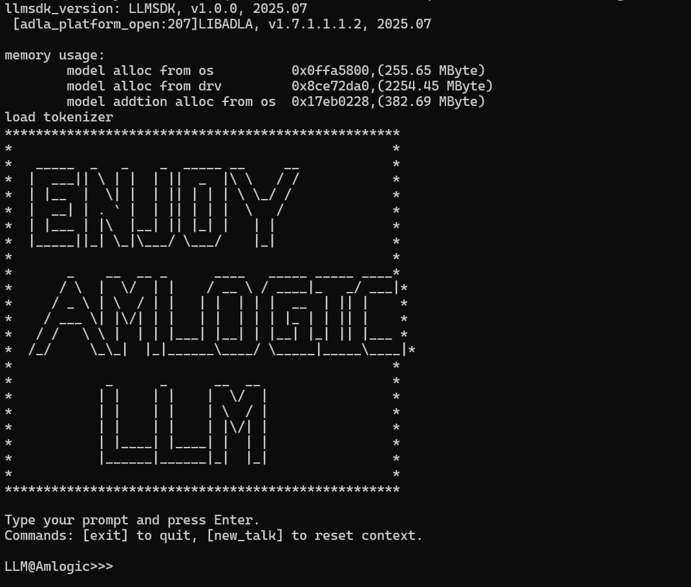

# LLM Examples

Run LLM inference on Amlogic devices using the LLMSDK C++ runtime or the optional Python toolkit.


## Models and SDKs

| Resource | Description |
| :--- | :--- |
| [ADLA Hub](https://huggingface.co/Amlogic-NN/amlnn-adla-models) | Pre-quantized ADLA models |
| [LLMSDK](https://github.com/Amlogic-NN/amlnn-toolkit/tree/main/amlnn_runtime/llm_runtime) | C++ runtime libraries and headers |
| [amlllm_edge_toolkit_lite](https://github.com/Amlogic-NN/amlnn-toolkit/tree/main/amlnn_toolkit_lite/amlllm_edge_toolkit_lite) | Optional Python inference toolkit |

Download an ADLA model for your target device and its matching tokenizer resources before running the examples.

## Workspace Setup

This guide assumes the following directory layout:

```text
workspace/
├── amlnn-model-playground/
│   └── examples/LLMs/
│       ├── cpp/
│       └── py/
└── amlnn-toolkit/
```

From the root of your existing `amlnn-model-playground` checkout, clone the SDK repository into the parent directory:

```bash
git clone https://github.com/Amlogic-NN/amlnn-toolkit.git ../amlnn-toolkit
```

Skip this step if the SDK repository is already present.

## C++ Example — Android

### 1. Configure the Android NDK

Set `NDK_PATH` to your Android NDK installation. The example below uses NDK r25c:

```bash
export NDK_PATH=/your/ndk/path/android-ndk-r25c
export PATH="$NDK_PATH:$PATH"
```

### 2. Build the Example

From the `amlnn-model-playground` repository root:

```bash
cd examples/LLMs/cpp
./build-android.sh
```

### 3. Deploy to the Device

Push the generated executable, ADLA model, and tokenizer to `/data/local/tmp`.

Run these commands on the host, replacing each placeholder with the actual local path:

```bash
adb push <executable_path>/demo_llm_main /data/local/tmp/
adb push <model_path>/Qwen2.5-0.5B-Instruct_quant_i8_a311d2.adla /data/local/tmp/
adb push <tokenizer_path>/tokenizer.json /data/local/tmp/
```

If the LLMSDK shared library is not already available on the device, deploy it as well:

```bash
adb push <llmsdk_path>/llmsdk.so /data/local/tmp/
```

Use the library filename supplied by your SDK package.

### 4. Run Inference

Open a device shell and run:

```bash
adb shell
cd /data/local/tmp
chmod +x demo_llm_main
export LD_LIBRARY_PATH="/vendor/lib64:/data/local/tmp${LD_LIBRARY_PATH:+:$LD_LIBRARY_PATH}"

./demo_llm_main Qwen2.5-0.5B-Instruct_quant_i8_a311d2.adla tokenizer.json
```

The model filename above is an A311D2 example. Replace it with the model package for your target device.

## Python Example — Arm64 Ubuntu / Debian

### Prerequisites

| Component | Requirement |
| :--- | :--- |
| Architecture | Linux aarch64 |
| OS | Ubuntu 22.04 or Debian |
| Python | 3.10 |
| NPU driver/runtime | Compatible ADLA software; LIBADLA 1.7.x or later |

> [!CAUTION]
> According to the release status supplied for this guide, the official system image is awaiting release. Use a board image with the required NPU driver and runtime installed.

### 1. Check the ADLA Installation

Run the following commands on the board through a serial console or terminal:

```bash
dmesg | grep -i adla
strings /usr/lib/libadla.so | grep LIBADLA
```

Check the driver information in the kernel log and the LIBADLA version reported by the shared library. This guide requires LIBADLA 1.7.x or later. If the library is installed elsewhere, adjust the path accordingly.

### 2. Create a Python Environment

Install Miniforge if needed:

```bash
wget https://github.com/conda-forge/miniforge/releases/latest/download/Miniforge3-Linux-aarch64.sh
bash Miniforge3-Linux-aarch64.sh
```

Follow the installer instructions, then reopen your shell if required. Create and activate the environment:

```bash
conda create -n amlllm_310 python=3.10 -y
conda activate amlllm_310
```

### 3. Install the Python Package

From the `amlnn-model-playground` repository root, locate the Python 3.10 / aarch64 wheel in the adjacent SDK checkout:

```bash
find ../amlnn-toolkit -type f -name 'amlllm-1.0.0-cp310-cp310-linux_aarch64.whl'
```

Install it using the path returned by the command:

```bash
python -m pip install <wheel_path>/amlllm-1.0.0-cp310-cp310-linux_aarch64.whl
```

If your SDK release provides a different package version, use its matching Python 3.10 / aarch64 wheel. See the [Python toolkit documentation](https://github.com/Amlogic-NN/amlnn-toolkit/tree/main/amlnn_toolkit_lite/amlllm_edge_toolkit_lite) for package-specific installation instructions.

### 4. Run the Chat Example

From the `amlnn-model-playground` repository root:

```bash
cd examples/LLMs/py

python simple_chat.py \
  --model <model_path> \
  --tokenizer <tokenizer_path> \
  [options]
```

Replace the placeholders with actual paths. Choose the model template that matches your model, as shown below.

### Command-Line Parameters

| Parameter | Description | Default |
| :--- | :--- | :--- |
| `--model` | **Required.** Path to the ADLA model file | — |
| `--tokenizer` | **Required.** Path to tokenizer resources | — |
| `--model-type` | Chat template: `none`, `qwen`, `deepseek`, `gemma`, `gemma3`, `llama`, `tiny_llama`, `tiny_llama_v0_4`, `phi_1_5`, or `phi_2` | `none` |
| `--sampling-mode` | Sampling mode: `argmax`, `top_p`, or `top_k` | `argmax` |
| `--top-k` | Top-K sampling parameter | `3` |
| `--top-p` | Top-P sampling parameter | `0.9` |
| `--temperature` | Softmax temperature | `1.0` |
| `--repeat-penalty` | Repetition penalty factor | `1.1` |
| `--loglevel` | Logging level: `DEBUG`, `INFO`, `WARNING`, or `ERROR` | `ERROR` |

### Usage Examples

**Qwen with the default sampling configuration:**

```bash
python simple_chat.py \
  --model Qwen2.5-0.5B-Instruct_quant_i8_a311d2.adla \
  --tokenizer tokenizer.json \
  --model-type qwen
```

**Top-P sampling:**

```bash
python simple_chat.py \
  --model Qwen2.5-0.5B-Instruct_quant_i8_a311d2.adla \
  --tokenizer tokenizer.json \
  --model-type qwen \
  --sampling-mode top_p \
  --top-p 0.9 \
  --temperature 0.8
```

**Top-K sampling:**

```bash
python simple_chat.py \
  --model Qwen2.5-0.5B-Instruct_quant_i8_a311d2.adla \
  --tokenizer tokenizer.json \
  --model-type qwen \
  --sampling-mode top_k \
  --top-k 5
```

### Interactive Commands

Once the chat interface starts, use the following inputs:

| Input | Action |
| :--- | :--- |
| Text followed by Enter | Submit a prompt and receive a streamed response |
| `new_talk` | Clear conversation history and start a new conversation |
| `break` | Request interruption of the current response |
| `exit` | Exit the program |
| `Ctrl+C` | Send an interrupt signal |

## Example Output



