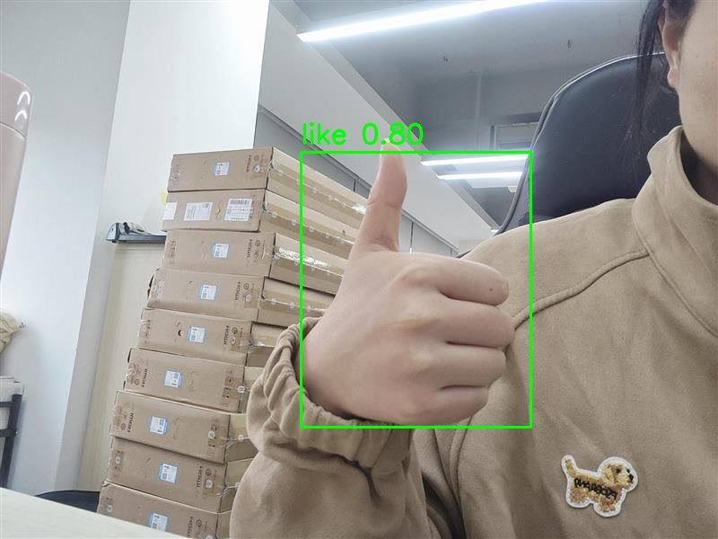
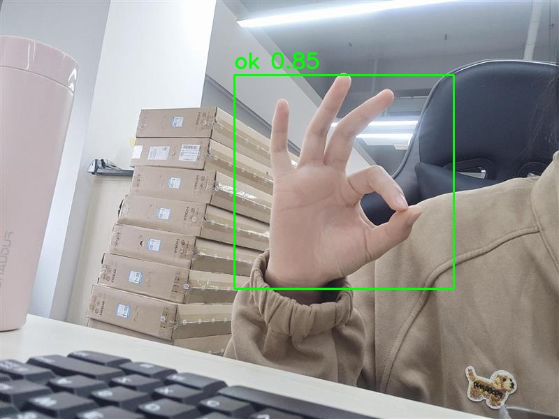

[EN](README.md) | **CN**

# 手势识别

本示例使用 AMLNN 运行 Gesture。完整流程如下：

1. 准备或下载 ONNX 模型。
2. 将 ONNX 模型转换为 ADLA 模型。
3. 使用 ADLA 模型运行 Python 示例。
4. 使用 ADLA 模型运行 C++（Linux/Android）示例。
5. 查看手势识别结果。

## 目录结构

```bash
examples/gesture/
├── cpp/               # C++ demo and build scripts
├── input/             # Input images for demo
├── model/             # Put ONNX and ADLA models here
├── py/                # Python conversion and demo scripts
└── result.jpg         # Example detection output
```

## 许可证

本示例代码基于 Apache License 2.0 授权。详情请参见仓库根目录的 [LICENSE](../../LICENSE) 文件。

该模型架构及其预训练权重最初来自阿里云 / [ModelScope](https://www.modelscope.cn/models/IoT-Edge/Gesture_Detect/summary)，该平台官方将此特定版本标注为 **Apache License 2.0**。

*免责声明：* 尽管上游提供方（ModelScope）已将该版本指定为 Apache 2.0，但该模型架构与 YOLO 系列模型在结构上存在相似之处。在将这些模型用于独立的商业再分发之前，最终用户有责任核实上游许可条款以及 HaGRID 数据集的使用条款。随附的标签文件包含来自 HaGRID 数据集的 19 个手势类别名称，此处提供仅为方便使用。

本示例中的模型预处理和后处理代码部分由 AI 生成。若任何部分与现有工作相似并引起疑虑，请联系我们，我们将予以删除或调整。

## 1. 准备 ONNX 模型

### 导出 ONNX

模型来源：

[ModelScope 手势检测模型](https://www.modelscope.cn/models/IoT-Edge/Gesture_Detect/files)

安装所需的软件包：

```bash
pip install torch torchvision onnx modelscope
```

运行 ONNX 下载/导出脚本：

```bash
cd examples/gesture/py
python onnx_download.py
```

将导出的 `gesture.onnx` 放到 `examples/gesture/model/` 目录下。

预期路径：

```text
examples/gesture/model/gesture.onnx
```

## 2. 将 ONNX 转换为 ADLA

在 `examples/gesture/py` 目录下运行 ADLA 导出脚本：

```bash
cd examples/gesture/py
python export_adla.py \
  --onnx ../model/gesture.onnx \
  --dataset-path ../../../resource/detection_dataset.txt \
  --target-platform 007 \
  --output-dir ../model
```

| 参数                | 说明                                                                                                                                             |
| ------------------- | ------------------------------------------------------------------------------------------------------------------------------------------------ |
| `--onnx`            | Gesture `.onnx` 模型的路径。                                                                                                                     |
| `--dataset-path`    | （可选）包含用于量化校准的输入路径的 `.txt` 文件路径。当前的 `w8a8` 配置需要该参数。[1]                                                          |
| `--target-platform` | 目标平台 ID。完整的支持平台列表见 [**此处**](../../docs/mapping.md)。                                                                            |
| `--output-dir`      | （可选）生成的 `.adla` 模型的保存目录。默认为 `../model`。                                                                                       |

> **[1] 量化数据集说明**
>
> 当前的 Gesture 导出配置使用 `w8a8`，需要校准数据集。如果未提供数据集，AMLNN 不会报错，而是生成随机校准数据，这可能严重降低模型精度。
>
> `activation_dtype` 不适用于 `w8a8`。

转换完成后，保留 AMLNN 生成的模型文件名。

预期模型路径：

```text
examples/gesture/model/gesture_w8a8.adla
```

## 3. 运行 Python 示例

### 前置条件

* Python 3.10
* 依赖包：`numpy`、`opencv-python`、`amlnn`

### 安装依赖

```bash
pip install numpy opencv-python amlnn_edge_toolkit-1.0.0-cp310-cp310-linux_aarch64.whl
```

### 在设备上运行

```bash
python gesture_inference.py \
    --adla ../model/gesture_w8a8.adla \
    --image-dir ../input
```

参数说明：

| 参数          | 说明                                              |
| ------------- | ------------------------------------------------- |
| `--adla`      | Gesture `.adla` 模型的路径。                      |
| `--image-dir` | 包含测试图像的目录。                              |
| `--top1-only` | （可选）仅保留得分最高的检测结果。                |

脚本会自动处理指定图像目录中所有图像文件（`.jpg`、`.jpeg`、`.png`、`.bmp`），并将检测结果保存到模型结果目录。

## 4. 运行 C++ 示例

### 为 Android 构建

#### 前置条件

* 已安装 **Android NDK**（推荐 r27d）。
* 已下载并解压 **AMLNN Toolkit**。
* `dependency/opencv/` 目录中已提供为 Android 预编译的 OpenCV。

#### 1. 配置环境

导出 NDK（工具链）和 AMLNN（神经网络依赖）的路径，以便脚本能够找到它们。

```bash
export ANDROID_NDK_PATH=/path/to/android-ndk-r27d
export AMLNN_HOME=/path/to/amlnn-toolkit/amlnn_runtime
```

#### 2. 构建

进入 C++ 目录并运行构建脚本。

```bash
cd examples/gesture/cpp

# Build for 64-bit (arm64-v8a) - Default
./build-android.sh

# Build for 32-bit (armeabi-v7a)
./build-android.sh -a armeabi-v7a
```

可执行文件将生成在所选 Android ABI 对应的构建目录中：

* 64 位：`build/android/arm64-v8a/gesture_demo`
* 32 位：`build/android/armeabi-v7a/gesture_demo`

#### 3. 运行示例

以下示例使用默认的 64 位（`arm64-v8a`）构建。

```bash
# Push executable and assets to device
adb shell "mkdir -p /data/local/tmp/"
adb push build/android/arm64-v8a/gesture_demo /data/local/tmp/
adb push ../model/gesture_w8a8.adla /data/local/tmp/
adb push ../input/ /data/local/tmp/

# Run on device
adb shell
cd /data/local/tmp
chmod +x gesture_demo
export LD_LIBRARY_PATH=/vendor/lib64

# Usage: ./gesture_demo <model_path> <image_dir> [--top1-only]
./gesture_demo gesture_w8a8.adla input/
```

仅保留得分最高的检测结果：

```bash
./gesture_demo gesture_w8a8.adla input/ --top1-only
```

> **注意：** 对于 32 位（`armeabi-v7a`）构建，请使用 `build/android/armeabi-v7a/gesture_demo` 及对应的 32 位库路径。请将 `gesture_w8a8.adla` 替换为实际生成的模型文件名。

---

### 为 Linux 构建

Linux 构建流程支持两种不同的模式：

1. **标准 Linux 交叉编译**（默认）
2. **Yocto SDK 编译**

#### 模式 1：标准 Linux 交叉编译（默认）

##### 前置条件

* GCC 交叉编译工具链（推荐 GCC 10.3）。
* 必须将工具链的 `bin/` 目录添加到系统的 `PATH` 中。
* `dependency/opencv/` 目录中已提供预编译的 OpenCV。
* 已设置 `AMLNN_HOME` 环境变量。

##### 1. 配置环境

将下载的工具链添加到 `PATH`，并导出 `AMLNN_HOME` 变量，以便脚本能够找到编译器和神经网络依赖。

```bash
# Export the AMLNN path
export AMLNN_HOME=/path/to/amlnn-toolkit/amlnn_runtime

# For 64-bit (aarch64) builds, add the 64-bit toolchain to PATH:
export PATH=/path/to/gcc-arm-10.3-2021.07-x86_64-aarch64-none-linux-gnu/bin:$PATH

# OR for 32-bit (arm) builds, add the 32-bit toolchain to PATH:
export PATH=/path/to/gcc-arm-10.3-2021.07-x86_64-arm-none-linux-gnueabihf/bin:$PATH
```

##### 2. 构建

```bash
cd examples/gesture/cpp

# Build for 64-bit (Default)
./build-linux.sh

# Build for 32-bit
./build-linux.sh -b 32
```

> **可选覆盖：** 如果你的编译器前缀名称不同（例如使用 `aarch64-linux-gnu` 而不是 `aarch64-none-linux-gnu`），可以通过设置 `GCC_COMPILER` 变量来覆盖默认值：

```bash
GCC_COMPILER=aarch64-linux-gnu ./build-linux.sh
```

可执行文件将生成在所选架构对应的构建目录中：

* 64 位：`build/linux/64/gesture_demo`
* 32 位：`build/linux/32/gesture_demo`

#### 模式 2：Yocto/Debian/Armbian 构建

##### 1. 前置条件

* 已安装 Yocto SDK。
* 已获得 CMake 工具链文件。
* `../../../dependency/opencv/`（相对于脚本目录）中已提供预编译的 OpenCV。

##### 2. 配置环境

```bash
# Export the AMLNN path
export AMLNN_HOME=/path/to/amlnn-toolkit/amlnn_runtime
```

##### 3. 构建

```bash
cd examples/gesture/cpp

# Build for Yocto 64-bit (Default)
./build-linux.sh -m yocto -s /path/to/yocto_sdk_root -t /path/to/toolchain.cmake

# Build for Yocto 32-bit
./build-linux.sh -m yocto -b 32 -s /path/to/yocto_sdk_root -t /path/to/toolchain.cmake
```

> **注意：** 也可以使用 `YOCTO_SDK_ROOT` 和 `TOOLCHAIN_FILE` 环境变量，而无需传入 `-s` 和 `-t` 参数。

可执行文件将生成在所选架构对应的构建目录中：

* 64 位：`build/yocto/64/gesture_demo`
* 32 位：`build/yocto/32/gesture_demo`

#### 3. 运行示例

以下示例使用默认的 64 位 Linux 构建。

```bash
# Push executable and assets to device (adjust build path if using Yocto)
adb shell "mkdir -p /data/local/tmp/"
adb push build/linux/64/gesture_demo /data/local/tmp/
adb push ../model/gesture_w8a8.adla /data/local/tmp/
adb push ../input/ /data/local/tmp/

# Run on device
adb shell
cd /data/local/tmp
chmod +x gesture_demo

# Usage: ./gesture_demo <model_path> <image_dir> [--top1-only]
./gesture_demo gesture_w8a8.adla input/
```

仅保留得分最高的检测结果：

```bash
./gesture_demo gesture_w8a8.adla input/ --top1-only
```

> **注意：** 请将 `gesture_w8a8.adla` 替换为实际生成的模型文件名。如果使用 32 位或 Yocto 构建，请调整可执行文件路径。

## 5. 结果

### 性能反馈

将日志级别设置为 `INFO` 后，程序会在推理完成后输出运行时性能信息。控制台输出可能包括：

* **硬件信息：** 系统版本和 ADLA 库版本。
* **模型概览：** 输入和输出张量配置。
* **NPU 指标：** 推理延迟和 DRAM 带宽占用。

### 检测输出

对于每张输入图像，Gesture 示例会执行手势识别，并生成包含检测到的边界框的可视化结果。

结果图像保存到 Gesture 结果目录。例如：

```text
gesture_result/
└── test_image_result.jpg
```

你可以从设备上拉取结果图像进行查看：

```bash
adb pull gesture_result/test_image_result.jpg
```




