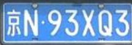

[EN](README.md) | **CN**

# LPRNet

本示例使用 AMLNN 运行 LPRNet。完整流程如下：

1. 准备或下载 ONNX 模型。
2. 将 ONNX 模型转换为 ADLA 模型。
3. 使用 ADLA 模型运行 Python 示例。
4. 使用 ADLA 模型运行 C++（Linux/Android）示例。
5. 查看车牌识别结果。

## 目录结构

```bash
examples/lprnet/
├── cpp/               # C++ demo and build scripts
├── input/             # Input images for demo
├── model/             # Put ONNX and ADLA models here
└── py/                # Python conversion and demo scripts
```

## 许可证

本示例代码基于 Apache License 2.0 许可。详情请参阅仓库根目录的 [LICENSE](../../LICENSE) 文件。

本示例使用的 LPRNet 模型由第三方提供（原始来源为 [https://github.com/sirius-ai/LPRNet_Pytorch/]），并以 Apache License 2.0 分发。在再分发或商业使用之前，请查阅并遵守原始模型来源的许可证与使用条款。

本示例中的模型预处理和后处理代码部分由 AI 生成。如果其中任何部分无意中与现有工作相似并引起疑虑，请联系我们，我们会及时移除或调整。

## 1. 准备 ONNX 模型

### 下载 ONNX

下载已准备好的 ONNX 模型：

### [点此下载 LPRNet ONNX 模型！](https://pub-8378326bd0fe4b1d9312a3847f6316a2.r2.dev/model_zoo/LPRNet/lprnet.onnx)

将下载的模型放置到：

```text
examples/lprnet/model/lprnet.onnx
```

## 2. 将 ONNX 转换为 ADLA

在 `examples/lprnet/py` 目录下运行 ADLA 导出脚本：

```bash
cd examples/lprnet/py
python export_adla.py \
  --onnx ../model/lprnet.onnx \
  --target-platform 007 \
  --output-dir ../model
```

| Parameter           | Description                                                                                     |
| ------------------- | ----------------------------------------------------------------------------------------------- |
| `--onnx`            | LPRNet `.onnx` 模型的路径。                                                                     |
| `--target-platform` | 目标平台 ID。完整的支持平台列表见[**此处**](../../docs/mapping.md)。                            |
| `--output-dir`      | （可选）生成的 `.adla` 模型的保存目录。默认为 `../model`。                                      |

预期的模型路径：

```text
examples/lprnet/model/lprnet_w8a16.adla
```

## 3. 运行 Python 示例

### 前置条件

* Python 3.10
* 所需软件包：`numpy`、`opencv-python`、`amlnn`

### 安装依赖

```bash
pip install numpy opencv-python amlnn_edge_toolkit-1.0.0-cp310-cp310-linux_aarch64.whl
```

### 在设备上运行

```bash
python lprnet_inference.py \
    --adla ../model/lprnet_w8a16.adla \
    --image-dir ../input
```

参数说明：

| Argument      | Description                       |
| ------------- | --------------------------------- |
| `--adla`      | LPRNet `.adla` 模型的路径。        |
| `--image-dir` | 存放测试图像的目录。               |

脚本会自动处理指定图像目录中的所有图像文件（`.jpg`、`.jpeg`、`.png`、`.bmp`），打印识别出的车牌文本，并将可视化结果保存到模型结果目录。

## 4. 运行 C++ 示例

### 为 Android 构建

#### 前置条件

* 系统中已安装 **Android NDK**（推荐 r27d）。
* 已下载并解压 **AMLNN Toolkit**。
* 位于 `dependency/opencv/` 目录下的 Android 预编译 OpenCV。

#### 1. 设置环境

导出 NDK 和 AMLNN 的路径，以便构建脚本能够找到所需的工具链和神经网络依赖。

```bash
export ANDROID_NDK_PATH=/path/to/android-ndk-r27d
export AMLNN_HOME=/path/to/amlnn-toolkit/amlnn_runtime
```

#### 2. 构建

```bash
cd examples/lprnet/cpp

# Build for 64-bit (arm64-v8a) - Default
./build-android.sh

# Build for 32-bit (armeabi-v7a)
./build-android.sh -a armeabi-v7a
```

可执行文件将生成在所选 Android ABI 对应的构建目录中：

* 64 位：`build/android/arm64-v8a/lprnet_demo`
* 32 位：`build/android/armeabi-v7a/lprnet_demo`

#### 3. 运行示例

以下示例使用默认的 64 位（`arm64-v8a`）构建。

```bash
# Push executable and assets to device
adb shell "mkdir -p /data/local/tmp/"
adb push build/android/arm64-v8a/lprnet_demo /data/local/tmp/
adb push ../model/lprnet_w8a16.adla /data/local/tmp/
adb push ../input/ /data/local/tmp/

# Run on device
adb shell
cd /data/local/tmp
chmod +x lprnet_demo
export LD_LIBRARY_PATH=/vendor/lib64

# Usage: ./lprnet_demo <model_path> <image_dir>
./lprnet_demo lprnet_w8a16.adla input/
```

> **注意：** 对于 32 位（`armeabi-v7a`）构建，请使用 `build/android/armeabi-v7a/lprnet_demo` 及对应的 32 位库路径。请将 `lprnet_w8a16.adla` 替换为实际生成的模型文件名。

---

### 为 Linux 构建

Linux 构建过程支持两种不同的方式：

1. **标准 Linux 交叉编译**（默认）
2. **Yocto SDK 编译**

#### 方式 1：标准 Linux 交叉编译（默认）

##### 前置条件

* GCC 交叉编译工具链（推荐 GCC 10.3）。
* 工具链的 `bin/` 目录必须已加入系统的 `PATH`。
* 位于 `dependency/opencv/` 目录下的预编译 OpenCV。
* 已设置 `AMLNN_HOME` 环境变量。

##### 1. 设置环境

```bash
# Export the AMLNN path
export AMLNN_HOME=/path/to/amlnn-toolkit/amlnn_runtime

# For 64-bit (aarch64) builds, add the 64-bit toolchain to PATH:
export PATH=/path/to/gcc-arm-10.3-2021.07-x86_64-aarch64-none-linux-gnu/bin:$PATH

# OR for 32-bit (arm) builds, add the 32-bit toolchain to PATH:
export PATH=/path/to/gcc-arm-10.3-2021.07-x86_64-arm-none-linux-gnueabihf/bin:$PATH
```

##### 2. 构建

```bash
cd examples/lprnet/cpp

# Build for 64-bit (Default)
./build-linux.sh

# Build for 32-bit
./build-linux.sh -b 32
```

> **可选覆盖：** 如果你的编译器前缀名称不同，例如使用 `aarch64-linux-gnu` 而非 `aarch64-none-linux-gnu`，可以通过设置 `GCC_COMPILER` 变量覆盖默认值：

```bash
GCC_COMPILER=aarch64-linux-gnu ./build-linux.sh
```

可执行文件将生成在所选架构对应的构建目录中：

* 64 位：`build/linux/64/lprnet_demo`
* 32 位：`build/linux/32/lprnet_demo`

#### 方式 2：Yocto/Debian/Armbian 构建

##### 1. 前置条件

* 已安装 Yocto SDK。
* 可用的 CMake 工具链文件。
* 位于 `../../../dependency/opencv/` 的预编译 OpenCV（相对于脚本所在目录）。

##### 2. 设置环境

```bash
export AMLNN_HOME=/path/to/amlnn-toolkit/amlnn_runtime
```

##### 3. 构建

```bash
cd examples/lprnet/cpp

# Build for Yocto 64-bit (Default)
./build-linux.sh -m yocto -s /path/to/yocto_sdk_root -t /path/to/toolchain.cmake

# Build for Yocto 32-bit
./build-linux.sh -m yocto -b 32 -s /path/to/yocto_sdk_root -t /path/to/toolchain.cmake
```

> **注意：** 也可以使用 `YOCTO_SDK_ROOT` 和 `TOOLCHAIN_FILE` 环境变量，而不必传入 `-s` 和 `-t` 选项。

可执行文件将生成在所选架构对应的构建目录中：

* 64 位：`build/yocto/64/lprnet_demo`
* 32 位：`build/yocto/32/lprnet_demo`

#### 3. 运行示例

以下示例使用默认的 64 位 Linux 构建。

```bash
# Push executable and assets to device (adjust build path if using Yocto)
adb shell "mkdir -p /data/local/tmp/"
adb push build/linux/64/lprnet_demo /data/local/tmp/
adb push ../model/lprnet_w8a16.adla /data/local/tmp/
adb push ../input/ /data/local/tmp/

# Run on device
adb shell
cd /data/local/tmp
chmod +x lprnet_demo

# Usage: ./lprnet_demo <model_path> <image_dir>
./lprnet_demo lprnet_w8a16.adla input/
```

> **注意：** 请将 `lprnet_w8a16.adla` 替换为实际生成的模型文件名。如果使用 32 位或 Yocto 构建，请相应调整可执行文件路径。

## 5. 结果

### 性能反馈

将日志级别设置为 `INFO` 后，程序会在推理结束后提供运行时性能信息。控制台输出可能包含：

* **硬件信息：** 系统和 ADLA 库版本。
* **模型概览：** 输入和输出张量配置。
* **NPU 指标：** 推理时延和 DRAM 带宽占用。

### 车牌识别输出

对于每张输入图像，程序会执行车牌识别，打印识别出的车牌文本，并保存结果可视化图。

示例：

```text
============================================================
Processing image: "plate_only.png"
============================================================
Inference time: 0.843059 ms
    Recognized Plate: [京N93XQ3]
    Image saved to: lprnet_w8a16_result/plate_only_result.jpg
============================================================
```

示例结果路径：

```text
lprnet_w8a16_result/
└── plate_only_result.jpg
```

示例输入：


