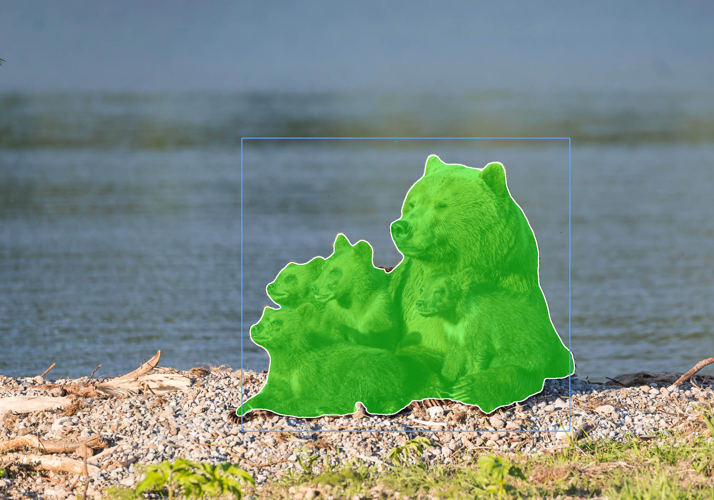

[EN](README.md) | **CN**

# MobileSAM 示例

本示例使用 AMLNN 运行 MobileSAM。完整流程如下：

1. 准备或下载 ONNX 模型。
2. 将 ONNX 模型转换为 ADLA 模型。
3. 使用 ADLA 模型运行 Python 示例。
4. 使用 ADLA 模型运行 C++（Linux/Android）示例。
5. 查看分割结果。

## 目录结构

```bash
examples/mobilesam/
├── cpp/               # C++ demo and build scripts
├── input/             # Input images for demo
├── model/             # Put ONNX and ADLA models here
├── py/                # Python conversion and demo scripts
└── result.jpg         # Example segmentation output
```

## 许可证

本示例代码采用 Apache License 2.0 许可证。详情请参阅仓库根目录的 [LICENSE](../../LICENSE) 文件。

MobileSAM 模型由第三方提供。再分发或商业使用前，请查阅并遵守模型来源方的许可证与使用条款。

本示例中的模型预处理和后处理代码部分由 AI 生成。如果任何部分与已有工作相似并引起顾虑，请联系我们，我们会及时删除或调整。

## 1. 准备 ONNX 模型

### 下载 ONNX

MobileSAM 模型提供 `448x448` 和 `1024x1024` 两种输入分辨率版本。

### 448x448

### [在此下载 448x448 编码器 ONNX！](https://pub-8378326bd0fe4b1d9312a3847f6316a2.r2.dev/model_zoo/MobileSAM/448/mobile_sam_encoder_448.onnx)

### [在此下载 448x448 解码器 ONNX！](https://pub-8378326bd0fe4b1d9312a3847f6316a2.r2.dev/model_zoo/MobileSAM/448/mobile_sam_decoder_448_no_post_p2.onnx)

### 1024x1024

### [在此下载 1024x1024 编码器 ONNX！](https://pub-8378326bd0fe4b1d9312a3847f6316a2.r2.dev/model_zoo/MobileSAM/1024/mobile_sam_encoder.onnx)

### [在此下载 1024x1024 解码器 ONNX！](https://pub-8378326bd0fe4b1d9312a3847f6316a2.r2.dev/model_zoo/MobileSAM/1024/mobile_sam_decoder_no_post_p2.onnx)

将下载的 ONNX 模型放到 `examples/mobilesam/model/` 目录下。


## 2. 将 ONNX 转换为 ADLA

在 `examples/mobilesam/py` 目录下运行 ADLA 导出脚本。

以下示例转换 `448x448` 模型：

```bash
cd examples/mobilesam/py
python export_adla.py \
  --enc-onnx ../model/mobile_sam_encoder_448.onnx \
  --det-onnx ../model/mobile_sam_decoder_448_no_post_p2.onnx \
  --target-platform 007 \
  --output-dir ../model
```

| 参数                | 说明                                                                                    |
| ------------------- | ----------------------------------------------------------------------------------------------- |
| `--enc-onnx`        | MobileSAM 编码器 `.onnx` 模型的路径。                                                    |
| `--det-onnx`        | MobileSAM 解码器 `.onnx` 模型的路径。                                                    |
| `--target-platform` | 目标平台 ID。支持平台的完整列表见[**此处**](../../docs/mapping.md)。 |
| `--output-dir`      | （可选）生成的 `.adla` 模型的保存目录。默认为 `../model`。  |


## 3. 运行 Python 示例

### 前置条件

* Python 3.10
* 所需依赖包：`amlnn`

### 安装依赖

```bash
pip install amlnn_edge_toolkit_lite-1.0.0-cp310-cp310-linux_aarch64.whl
```

### 在设备上运行

以下示例使用 `448x448` 模型并传入边界框提示：

```bash
python infer_mobilesam_adla_448.py \
  --image ../input/picture5.jpg \
  --encoder ../model/mobile_sam_encoder_448_w8a16.adla \
  --decoder ../model/mobile_sam_decoder_448_no_post_p2_w8a16.adla \
  --box 700,400,1650,1250
```

参数说明：

| 参数                   | 说明                                                                                                                                                                                                           |
| ---------------------- | --------------------------------------------------------------------------------------------------------------------------------------------------------------------------------------------------------------------- |
| `--image`              | 待分割输入图像的路径。                                                                                                                                                                                   |
| `--encoder`            | 编译后的 MobileSAM 编码器 `.adla` 模型的路径。                                                                                                                                                                 |
| `--decoder`            | 编译后的 MobileSAM 解码器 `.adla` 模型的路径。                                                                                                                                                                 |
| `--points`             | （可选）`"x,y,label"` 格式的点提示，或用分号分隔的多个点 `"x1,y1,l1;x2,y2,l2"`。标签 `1` 表示正点，`0` 表示负点。默认为 `None`。 |
| `--box`                | （可选）`"x1,y1,x2,y2"` 格式的边界框提示。默认为 `None`。                                                                                                                                         |
| `--decoder-num-points` | （可选）解码器期望的固定输入点数。默认为 `2`。                                                                                                                                     |
| `--no-padding`         | （可选）阻止脚本自动追加一个 `-1` 填充点。默认为 `False`。                                                                                                                |
| `--mask-index`         | （可选）选择指定的生成掩码索引。默认值 `-1` 会自动选择置信度最高的掩码。                                                                                |
| `--output`             | （可选）分割叠加图的保存路径。默认为 `./result_adla_448_overlay.png`。                                                                                                      |

Python 示例使用给定的点提示或边界框提示处理指定的输入图像，并将生成的分割叠加图保存到 `--output` 指定的路径。

## 4. 运行 C++ 示例

### 构建 Android 版本

#### 前置条件

* **Android NDK**（推荐 r27d）已安装在系统中。
* 已下载并解压 **AMLNN Toolkit**。
* 预编译的 Android OpenCV 位于 `dependency/opencv/` 目录。

#### 1. 设置环境

导出 NDK 和 AMLNN 的路径，使构建脚本能够找到所需的工具链和神经网络依赖库。

```bash
export ANDROID_NDK_PATH=/path/to/android-ndk-r27d
export AMLNN_HOME=/path/to/amlnn-toolkit/amlnn_runtime
```

#### 2. 构建

```bash
cd examples/mobilesam/cpp

# Build for 64-bit (arm64-v8a) - Default
./build-android.sh

# Build for 32-bit (armeabi-v7a)
./build-android.sh -a armeabi-v7a
```

可执行文件将生成在对应所选 Android ABI 的构建目录中：

* 64 位：`build/android/arm64-v8a/mobilesam_demo`
* 32 位：`build/android/armeabi-v7a/mobilesam_demo`

#### 3. 运行示例

以下示例使用默认的 64 位（`arm64-v8a`）构建和 `1024x1024` 模型：

```bash
# Push executable and assets to device
adb shell "mkdir -p /data/local/tmp/"
adb push build/android/arm64-v8a/mobilesam_demo /data/local/tmp/
adb push ../model/mobile_sam_encoder_w8a16.adla /data/local/tmp/
adb push ../model/mobile_sam_decoder_no_post_p2_w8a16.adla /data/local/tmp/
adb push ../input/ /data/local/tmp/

# Run on device
adb shell
cd /data/local/tmp
chmod +x mobilesam_demo
export LD_LIBRARY_PATH=/vendor/lib64

# Usage: ./mobilesam_demo <encoder.adla> <decoder.adla> <image> <point|box> <values>
# Point: "x,y,label" or "x1,y1,l1;x2,y2,l2"
# Box:   "x1,y1,x2,y2"
./mobilesam_demo mobile_sam_encoder_w8a16.adla mobile_sam_decoder_no_post_p2_w8a16.adla ./input/picture5.jpg box 700,400,1650,1250
```

> **注意：** 32 位（`armeabi-v7a`）构建请使用 `build/android/armeabi-v7a/mobilesam_demo` 及对应的 32 位库路径。请将 `.adla` 文件名替换为你实际生成的模型文件名。

---

### 构建 Linux 版本

Linux 构建流程支持两种不同模式：

1. **标准 Linux 交叉编译**（默认）
2. **Yocto SDK 编译**

#### 方式 1：标准 Linux 交叉编译（默认）

##### 前置条件

* GCC 交叉编译工具链（推荐 GCC 10.3）。
* 工具链的 `bin/` 目录必须加入系统 `PATH`。
* 预编译的 OpenCV 位于 `dependency/opencv/` 目录。
* 已设置 `AMLNN_HOME` 环境变量。

##### 1. 设置环境

```bash
# Export the AMLNN path
export AMLNN_HOME=/path/to/amlnn-toolkit/amlnn_runtime

# For 64-bit (aarch64) builds, add the 64-bit toolchain to PATH:
export PATH=/path/to/gcc-arm-10.3-2021.07-x86_64-aarch64-none-linux-gnu/bin:$PATH

# OR for 32-bit (arm) builds, add the 32-bit toolchain to PATH:
export PATH=/path/to/gcc-arm-10.3-2021.07-x86_64-arm-none-linux-gnueabihf/bin:$PATH
```

##### 2. 构建

```bash
cd examples/mobilesam/cpp

# Build for 64-bit (Default)
./build-linux.sh

# Build for 32-bit
./build-linux.sh -b 32
```

> **可选覆盖：** 如果你的编译器前缀名称不同，例如使用 `aarch64-linux-gnu` 而非 `aarch64-none-linux-gnu`，可以通过设置 `GCC_COMPILER` 变量覆盖默认值：

```bash
GCC_COMPILER=aarch64-linux-gnu ./build-linux.sh
```

可执行文件将生成在对应所选架构的构建目录中：

* 64 位：`build/linux/64/mobilesam_demo`
* 32 位：`build/linux/32/mobilesam_demo`

#### 方式 2：Yocto/Debian/Armbian 构建

##### 1. 前置条件

* 已安装 Yocto SDK。
* 已准备好 CMake 工具链文件。
* 预编译的 OpenCV 位于 `../../../dependency/opencv/`（相对于脚本目录）。

##### 2. 设置环境

```bash
export AMLNN_HOME=/path/to/amlnn-toolkit/amlnn_runtime
```

##### 3. 构建

```bash
cd examples/mobilesam/cpp

# Build for Yocto 64-bit (Default)
./build-linux.sh -m yocto -s /path/to/yocto_sdk_root -t /path/to/toolchain.cmake

# Build for Yocto 32-bit
./build-linux.sh -m yocto -b 32 -s /path/to/yocto_sdk_root -t /path/to/toolchain.cmake
```

> **注意：** 也可以使用 `YOCTO_SDK_ROOT` 和 `TOOLCHAIN_FILE` 环境变量，而不传入 `-s` 和 `-t` 参数。

可执行文件将生成在对应所选架构的构建目录中：

* 64 位：`build/yocto/64/mobilesam_demo`
* 32 位：`build/yocto/32/mobilesam_demo`

#### 3. 运行示例

以下示例使用默认的 64 位 Linux 构建和 `1024x1024` 模型：

```bash
# Push executable and assets to device (adjust build path if using Yocto)
adb shell "mkdir -p /data/local/tmp/"
adb push build/linux/64/mobilesam_demo /data/local/tmp/
adb push ../model/mobile_sam_encoder_w8a16.adla /data/local/tmp/
adb push ../model/mobile_sam_decoder_no_post_p2_w8a16.adla /data/local/tmp/
adb push ../input/ /data/local/tmp/

# Run on device
adb shell
cd /data/local/tmp
chmod +x mobilesam_demo

# Usage: ./mobilesam_demo <encoder.adla> <decoder.adla> <image> <point|box> <values>
# Point: "x,y,label" or "x1,y1,l1;x2,y2,l2"
# Box:   "x1,y1,x2,y2"
./mobilesam_demo mobile_sam_encoder_w8a16.adla mobile_sam_decoder_no_post_p2_w8a16.adla ./input/picture5.jpg box 700,400,1650,1250
```

> **注意：** 请将 `.adla` 文件名替换为你实际生成的模型文件名。如果使用 32 位或 Yocto 构建，请相应调整可执行文件路径。

## 5. 结果

### 性能信息

将日志级别设置为 `INFO` 后，程序会在推理结束后输出运行时性能信息。控制台输出可能包括：

* **硬件信息：** 系统与 ADLA 库版本。
* **模型概览：** 输入和输出张量配置。
* **NPU 指标：** 推理时延与 DRAM 带宽占用。

### 分割输出

MobileSAM 使用点提示或边界框提示，为指定的目标或区域生成分割掩码。

Python `448x448` 示例将分割掩码叠加图保存到 `--output` 指定的路径。默认路径为：

```text
result_adla_448_overlay.png
```

示例结果：


