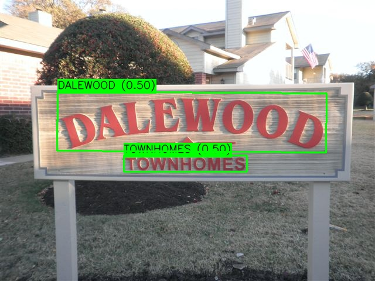

[EN](README.md) | **CN**

# PaddleOCR v4 系统

本示例使用 AMLNN 运行 PPOCR 系统，完整流程如下：

1. 准备或下载 ONNX 模型。
2. 将 ONNX 模型转换为 ADLA 模型。
3. 使用 ADLA 模型运行 Python 示例。
4. 使用 ADLA 模型运行 C++（Linux/Android）示例。
5. 查看文本检测与识别结果。

## 目录结构

```bash
examples/ppocr_v4_system/
├── cpp/               # C++ demo and build scripts
├── input/             # Input images for demo
├── model/             # Put ONNX and ADLA models here
├── py/                # Python conversion and demo scripts
└── result.jpg         # Example result
```

## 许可证

本示例代码基于 Apache License 2.0 许可。详情请参见仓库根目录的 [LICENSE](../../LICENSE) 文件。

本项目分发 PP-OCR 检测与识别模型，这些模型最初由百度（PaddlePaddle）开发，取自 PaddleOCR 官方仓库。模型权重与网络架构以宽松的 Apache 2.0 许可证提供。如果你要进一步分发这些模型文件或将它们用于商业用途，请务必保留 Apache 2.0 许可证声明。

本示例中的模型预处理与后处理代码部分由 AI 生成。若其中有内容与已有工作相似而引起顾虑，请联系我们，我们会将其删除或调整。

## 1. 准备 ONNX 模型

### 下载 ONNX

下载已准备好的 ONNX 模型：

### [在此下载 PaddleOCR Detection v4 ONNX 模型！](https://pub-8378326bd0fe4b1d9312a3847f6316a2.r2.dev/model_zoo/ppocr_det_v4/ppocr_det_static.onnx)

### [在此下载 PaddleOCR Recognition v4 ONNX 模型！](https://pub-8378326bd0fe4b1d9312a3847f6316a2.r2.dev/model_zoo/ppocr_rec_v4/ppocr_rec_static.onnx)

将下载的模型放到以下路径：

```text
examples/ppocr_v4_system/model/ppocr_det_static.onnx
examples/ppocr_v4_system/model/ppocr_rec_static.onnx
```

## 2. 将 ONNX 转换为 ADLA

在 `examples/ppocr_v4_system/py` 目录下运行 ADLA 导出脚本：

```bash
cd examples/ppocr_v4_system/py
python export_adla.py \
  --det-onnx ../model/ppocr_det_static.onnx \
  --rec-onnx ../model/ppocr_rec_static.onnx \
  --det-dataset-path ../../../resource/sign_dataset.txt \
  --target-platform 007 \
  --output-dir ../model
```

| 参数                 | 说明                                                                                                                                                             |
| -------------------- | ---------------------------------------------------------------------------------------------------------------------------------------------------------------- |
| `--det-onnx`         | PaddleOCR Detection v4 `.onnx` 模型的路径。                                                                                                                      |
| `--rec-onnx`         | PaddleOCR Recognition v4 `.onnx` 模型的路径。                                                                                                                    |
| `--det-dataset-path` | （可选）包含检测模型量化校准所用输入路径的 `.txt` 文件路径。当前的 `w8a8` 与 `w8a16 (i16)` 配置需要该项。[1] |
| `--target-platform`  | 目标平台 ID。支持平台的完整列表见 [**此处**](../../docs/mapping.md)。                                                                                            |
| `--output-dir`       | （可选）生成的 `.adla` 模型保存目录，默认为 `../model`。                                                                                                         |

> **[1] 量化数据集说明**
>
> 使用 `activation_dtype="f16"`（例如 `w8a16 (f16)` 或 `w16a16 (f16)`）时**不需要**校准数据集。请在 `amlnn.config()` 调用中显式设置该参数。PaddleOCR 识别模型使用 `w8a16 (f16)`，因此不需要校准数据集。
>
> 如果未提供数据集，AMLNN 会生成随机校准数据而不是报错，这可能会严重降低模型精度。
>
> `activation_dtype` 不适用于 `w8a8`。PaddleOCR 检测模型使用 `w8a8`，因此需要校准数据集才能正确完成量化。

转换后，AMLNN 生成的模型文件名会保持不变。在当前的检测 `w8a8` 与识别 `w8a16 (f16)` 配置下，预期的模型路径为：

```text
examples/ppocr_v4_system/model/ppocr_det_static_w8a8.adla
examples/ppocr_v4_system/model/ppocr_rec_static_w8a16.adla
```

## 3. 运行 Python 示例

### 前置条件

* Python 3.10
* 所需软件包：`numpy`、`opencv-python`、`amlnn`

### 安装依赖

```bash
pip install numpy opencv-python amlnn_edge_toolkit-1.0.0-cp310-cp310-linux_aarch64.whl
```

### 在设备上运行

```bash
python ppocr_inference.py \
    --det ../model/ppocr_det_static_w8a8.adla \
    --rec ../model/ppocr_rec_static_w8a16.adla \
    --dict ../input/ppocr_keys_v1.txt \
    --image-dir ../input
```

参数说明：

| 参数          | 说明                                                   |
| ------------- | ------------------------------------------------------ |
| `--det` | PaddleOCR Detection v4 `.adla` 模型的路径。            |
| `--rec` | PaddleOCR Recognition v4 `.adla` 模型的路径。          |
| `--dict` | PP-OCR 识别字典 `.txt` 文件的路径。                    |
| `--image-dir` | 包含测试图像的目录。                                   |

脚本会自动处理指定图像目录下所有图像文件（`.jpg`、`.jpeg`、`.png`、`.bmp`），检测文本区域、识别检测到的文本，并保存可视化结果。

使用示例模型时，结果图像保存在：

```text
ppocr_det_static_w8a8_end2end_result/
```

## 4. 运行 C++ 示例

### 为 Android 构建

#### 前置条件

* 系统已安装 **Android NDK**（建议 r27d）。
* 已下载并解压 **AMLNN Toolkit**。
* 位于 `dependency/opencv/` 目录下、为 Android 预编译的 OpenCV。

#### 1. 设置环境

导出 NDK（工具链）与 AMLNN（神经网络依赖）的路径，以便脚本能够找到它们。

```bash
export ANDROID_NDK_PATH=/path/to/android-ndk-r27d
export AMLNN_HOME=/path/to/amlnn-toolkit/amlnn_runtime
```

#### 2. 构建

进入 C++ 目录并运行构建脚本。

```bash
cd examples/ppocr_v4_system/cpp

# Build for 64-bit (arm64-v8a) - Default
./build-android.sh

# Build for 32-bit (armeabi-v7a)
./build-android.sh -a armeabi-v7a
```

可执行文件将生成在所选 Android ABI 对应的构建目录中：

* 64 位：`build/android/arm64-v8a/ppocrv4_demo`
* 32 位：`build/android/armeabi-v7a/ppocrv4_demo`

#### 3. 运行示例

以下示例使用默认的 64 位（`arm64-v8a`）构建。

```bash
# Push executable and assets to device
adb shell "mkdir -p /data/local/tmp/"
adb push build/android/arm64-v8a/ppocrv4_demo /data/local/tmp/
adb push ../model/ppocr_det_static_w8a8.adla /data/local/tmp/
adb push ../model/ppocr_rec_static_w8a16.adla /data/local/tmp/
adb push ../input/ /data/local/tmp/

# Run on device
adb shell
cd /data/local/tmp
chmod +x ppocrv4_demo
export LD_LIBRARY_PATH=/vendor/lib64

# Usage: ./ppocrv4_demo <det_model.adla> <rec_model.adla> <image_dir> <dict_path>
./ppocrv4_demo ppocr_det_static_w8a8.adla ppocr_rec_static_w8a16.adla input/ input/ppocr_keys_v1.txt
```

> **注意：** 对 32 位（`armeabi-v7a`）构建，请使用 `build/android/armeabi-v7a/ppocrv4_demo` 及对应的 32 位库路径。请将 ADLA 文件名替换为实际生成的模型文件名。

---

### 为 Linux 构建

Linux 构建支持两种不同的模式：

1. **标准 Linux 交叉编译**（默认）
2. **Yocto SDK 编译**

#### 模式 1：标准 Linux 交叉编译（默认）

##### 前置条件

* GCC 交叉编译工具链（建议 GCC 10.3）。
* 工具链的 `bin/` 目录必须添加到系统的 `PATH` 中。
* 位于 `dependency/opencv/` 目录下、预编译好的 OpenCV。
* 已设置 `AMLNN_HOME` 环境变量。

##### 1. 设置环境

将下载的工具链添加到 `PATH`，并导出 `AMLNN_HOME` 变量，以便脚本能够找到编译器与神经网络依赖。

```bash
# Export the AMLNN path
export AMLNN_HOME=/path/to/amlnn-toolkit/amlnn_runtime

# For 64-bit (aarch64) builds, add the 64-bit toolchain to PATH:
export PATH=/path/to/gcc-arm-10.3-2021.07-x86_64-aarch64-none-linux-gnu/bin:$PATH

# OR for 32-bit (arm) builds, add the 32-bit toolchain to PATH:
export PATH=/path/to/gcc-arm-10.3-2021.07-x86_64-arm-none-linux-gnueabihf/bin:$PATH
```

##### 2. 构建

```bash
cd examples/ppocr_v4_system/cpp

# Build for 64-bit (Default)
./build-linux.sh

# Build for 32-bit
./build-linux.sh -b 32
```

> **可选覆盖：** 如果编译器的前缀名称不同（例如用 `aarch64-linux-gnu` 而非 `aarch64-none-linux-gnu`），可通过设置 `GCC_COMPILER` 变量覆盖默认值：

```bash
GCC_COMPILER=aarch64-linux-gnu ./build-linux.sh
```

可执行文件将生成在所选架构对应的构建目录中：

* 64 位：`build/linux/64/ppocrv4_demo`
* 32 位：`build/linux/32/ppocrv4_demo`

#### 模式 2：Yocto/Debian/Armbian 构建

##### 1. 前置条件

* 已安装 Yocto SDK。
* 已具备 CMake 工具链文件。
* 预编译好的 OpenCV 位于 `../../../dependency/opencv/`（相对于脚本目录）。

##### 2. 设置环境

```bash
# Export the AMLNN path
export AMLNN_HOME=/path/to/amlnn-toolkit/amlnn_runtime
```

##### 3. 构建

```bash
cd examples/ppocr_v4_system/cpp

# Build for Yocto 64-bit (Default)
./build-linux.sh -m yocto -s /path/to/yocto_sdk_root -t /path/to/toolchain.cmake

# Build for Yocto 32-bit
./build-linux.sh -m yocto -b 32 -s /path/to/yocto_sdk_root -t /path/to/toolchain.cmake
```

> **注意：** 也可以使用 `YOCTO_SDK_ROOT` 和 `TOOLCHAIN_FILE` 环境变量，而无需传入 `-s` 和 `-t` 参数。

可执行文件将生成在所选架构对应的构建目录中：

* 64 位：`build/yocto/64/ppocrv4_demo`
* 32 位：`build/yocto/32/ppocrv4_demo`

#### 3. 运行示例

以下示例使用默认的 64 位 Linux 构建。

```bash
# Push executable and assets to device (adjust build path if using Yocto)
adb shell "mkdir -p /data/local/tmp/"
adb push build/linux/64/ppocrv4_demo /data/local/tmp/
adb push ../model/ppocr_det_static_w8a8.adla /data/local/tmp/
adb push ../model/ppocr_rec_static_w8a16.adla /data/local/tmp/
adb push ../input/ /data/local/tmp/

# Run on device
adb shell
cd /data/local/tmp
chmod +x ppocrv4_demo

# Usage: ./ppocrv4_demo <det_model.adla> <rec_model.adla> <image_dir> <dict_path>
./ppocrv4_demo ppocr_det_static_w8a8.adla ppocr_rec_static_w8a16.adla input/ input/ppocr_keys_v1.txt
```

> **注意：** 请将 ADLA 文件名替换为实际生成的模型文件名。如果使用 32 位或 Yocto 构建，请相应调整可执行文件路径。

## 5. 结果

### 性能信息反馈

将日志级别设置为 `INFO` 后，程序会在推理结束后输出运行时性能信息。控制台输出可能包含：

* **硬件信息：** 系统与 ADLA 库版本。
* **模型概览：** 输入与输出张量配置。
* **NPU 指标：** 推理延迟与 DRAM 带宽占用。

### 检测与识别输出

对每张输入图像，示例会检测文本区域、对每个检测到的区域执行文本识别、打印识别出的文本，并保存包含检测文本区域的可视化结果。

结果图像以输入图像名称保存在端到端结果目录中。对于示例模型：

```text
ppocr_det_static_w8a8_end2end_result/
└── test_sign_result.jpg
```

控制台输出示例：

```text
============================================================
Processing image 1/1: test_sign.jpg
============================================================
    [RESULT] Detected 2 objects.
    --------------------------------------------------------
    [RESULT] Box 0 - Text: [TOWNHOMES]
    [RESULT] Box 1 - Text: [DALEWOOD]
    Image saved to: ppocr_det_static_w8a8_end2end_result/test_sign_result.jpg
============================================================
```

可以从设备上拉取结果图像以便查看：

```bash
adb pull ppocr_det_static_w8a8_end2end_result/test_sign_result.jpg
```


