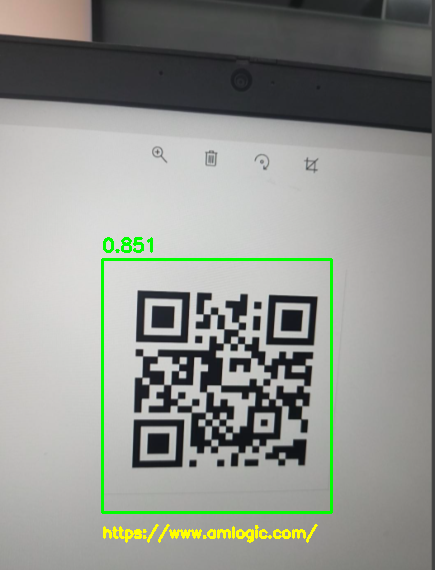

[EN](README.md) | **CN**

# qrcode 示例

本示例使用 AMLNN 运行二维码检测与解码。

## 目录结构

```text
examples/qrcode/
|-- cpp/                  # C++ demo and build scripts
|-- input/                # Input images for demo
|-- model/                # Put ONNX and ADLA models here
|-- py/                   # Python conversion and demo scripts
`-- result.jpg            # Example detection output
```

## 许可证

本示例代码基于 Apache License 2.0 许可发布。详情请参见仓库根目录的 [LICENSE](../../LICENSE) 文件。

qrcode 模型由第三方提供。在再分发或商业使用之前，请核对并遵守模型来源方的许可证与使用条款。

本示例中的模型预处理和后处理代码由 AI 生成。如果其中任何部分与已有工作相似并引起疑虑，请联系我们，我们会将其删除或调整。


## 1. 运行 Python 示例

### 前置条件

- Python 3.10
- `numpy`
- `opencv-python`
- 适用于目标设备的 AMLNN Python wheel

在目标设备上安装依赖：

```bash
pip install numpy opencv-python amlnn_edge_toolkit-1.0.0-cp310-cp310-linux_aarch64.whl
```

运行图像推理：
```bash
cd examples/qrcode/py
python qrcode.py \
    --model-path ../model/qrcode_int8.tflite \
    --dataset-path ../../../resource/detection_dataset.txt \
    --target-platform 007 \
    --image-dir ../input
```

Python 示例参数：

| 参数 | 说明 |
| --- | --- |
| `--model-path` | tflite 模型路径。 |
| `--image-dir` | 测试图片所在目录。|
| `--dataset-path` | 量化数据集路径。 |
| `--target-platform` | 平台 ID。A311D2：003。S905X5：005。C302X2：006。A311Y3：007。 |

随后将结果保存到 `qrcode_result`。

## 3. 运行 C++ 示例

### 为 Android 构建

前置条件：

- Android NDK，建议使用 r25e
- 已设置 `ANDROID_NDK_PATH`、`ANDROID_NDK` 或 `ANDROID_NDK_HOME`
- `AMLNN_HOME` 指向 AMLNN 工具包

构建：

```bash
# Build for arm64-v8a
cd examples/qrcode/cpp
AMLNN_HOME=/path/to/amlnn-toolkit ./build-android.sh -a arm64-v8a
```

可执行文件生成于：
```text
examples/qrcode/cpp/build/android/qr_demo
```

### 在设备上运行

推送文件：

```bash
adb push build/android/qr_demo /data/local/tmp/
adb push ../model/qrcode_int8_A311D2.adla /data/local/tmp/
adb push ../input /data/local/tmp/qrcode_input
```

运行：

```bash
adb shell
cd /data/local/tmp
chmod +x qr_demo
export LD_LIBRARY_PATH=/vendor/lib64
./qr_demo qrcode_int8_A311D2.adla ./qrcode_input
```

用法：

```text
./qr_demo <model.adla> <image_dir>
```

## 4. 结果

**检测输出**

对每张图片，程序会打印处理信息，包括推理性能（平均耗时、FPS 和带宽）、检测结果（目标数量、置信度、边界框坐标以及解码出的二维码内容），以及保存的输出图片路径。
带有边界框和解码二维码结果的输出图片将保存到 `qrcode_result` 文件夹。你可以将结果文件夹拉取回来查看：
```bash
adb pull /data/local/tmp/qrcode_result
```

