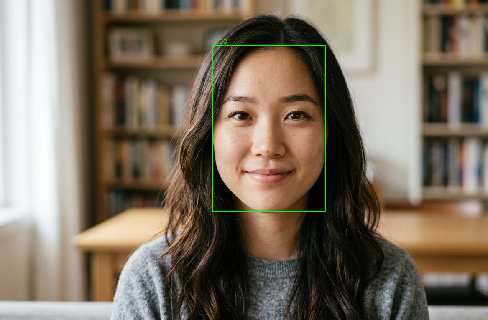

[EN](README.md) | **CN**

# RetinaFace 示例

本示例使用 AMLNN 运行 RetinaFace 人脸检测。完整流程如下：

1. 准备或下载 ONNX 模型。
2. 将 ONNX 模型转换为 ADLA 模型。
3. 使用 ADLA 模型运行 Python 示例。
4. 使用 ADLA 模型运行 C++（Linux/Android）示例。
5. 查看人脸检测结果。

## 目录结构

```bash
examples/retinaface/
├── cpp/                  # C++ demo and build scripts
├── input/                # Input images for demo
├── model/                # Put ONNX and ADLA models here
├── py/                   # Python conversion and demo scripts
└── result.jpg            # Example detection output
```

## 许可证

本示例代码采用 Apache License 2.0 许可证。详情请参阅仓库根目录的 [LICENSE](../../LICENSE) 文件。

RetinaFace 模型由第三方提供。在重新分发或商业使用前，请确认并遵守模型来源方的许可证与使用条款。

本示例中的模型预处理和后处理代码由 AI 生成。如果其中任何部分与现有工作相似而引起疑虑，请联系我们，我们将删除或调整相关代码。

## 1. 准备 ONNX 模型

模型来源：https://www.modelscope.cn/models/iic/cv_resnet50_face-detection_retinaface/files

你可以从 ModelScope PyTorch 模型导出 ONNX 模型，也可以直接下载已准备好的 ONNX 模型。

### 方案 A：导出 ONNX

安装或克隆 ModelScope 模型包：

```bash
git clone https://www.modelscope.cn/iic/cv_resnet50_face-detection_retinaface.git
```

将 `pytorch_model.pt` 和 `configuration.json` 放到 `py/convert_to_onnx.py` 能够加载的位置。建议将这两个文件放在：

```text
examples/retinaface/py/
```

然后运行：

```bash
cd examples/retinaface/py
python convert_to_onnx.py
```

脚本默认输出 `retinaface_resnet50.onnx`。

将导出的模型放到：

```text
examples/retinaface/model/retinaface_resnet50.onnx
```

### 方案 B：下载 ONNX

下载已准备好的 ONNX 模型：

- [在此下载 RetinaFace ResNet-50 ONNX 模型！](https://pub-8378326bd0fe4b1d9312a3847f6316a2.r2.dev/model_zoo/retinaface/retinaface_resnet50.onnx)

将下载的模型放到：

```text
examples/retinaface/model/retinaface_resnet50.onnx
```

## 2. 将 ONNX 转换为 ADLA

在 `examples/retinaface/py` 目录下运行 ADLA 导出脚本：

```bash
cd examples/retinaface/py
python export_adla.py \
  --onnx ../model/retinaface_resnet50.onnx \
  --dataset-path ../../../resource/detection_dataset.txt \
  --target-platform 007 \
  --output-dir ../model
```

| 参数                | 说明                                                                                                                                    |
| ------------------- | ---------------------------------------------------------------------------------------------------------------------------------------- |
| `--onnx`            | RetinaFace `.onnx` 模型的路径。                                                                                                          |
| `--dataset-path`    | （可选）包含用于量化校准的输入路径的 `.txt` 文件路径。`w8a8` 和 `w8a16 (i16)` 需要此项。[1]                                              |
| `--target-platform` | 目标平台 ID。完整支持平台列表请参见[**此处**](../../docs/mapping.md)。                                                                   |
| `--output-dir`      | （可选）生成的 `.adla` 模型保存目录。默认值为 `../model`。                                                                               |

> **[1] 量化数据集说明**
>
> 使用 `activation_dtype="f16"`（例如 `w8a16 (f16)` 或 `w16a16 (f16)`）时**不需要**校准数据集。请在 `amlnn.config()` 调用中显式设置该项。
>
> 如果未提供数据集，AMLNN 会生成随机校准数据而不是报错，这可能严重降低模型精度。
>
> `activation_dtype` 不适用于 `w8a8`。当前的 RetinaFace 模型使用 `w8a8`，因此需要校准数据集才能正确量化。

转换完成后，AMLNN 生成的模型文件名会保持不变。对于采用当前 `w8a8` 配置的 `retinaface_resnet50.onnx` 模型，预期的模型路径为：

```text
examples/retinaface/model/retinaface_resnet50_w8a8.adla
```

## 3. 运行 Python 示例

### 前置条件

* Python 3.10
* 所需软件包：`numpy`、`opencv-python`、`amlnn`

### 安装依赖

```bash
pip install numpy opencv-python amlnn_edge_toolkit-1.0.0-cp310-cp310-linux_aarch64.whl
```

### 在设备上运行

运行图像推理：

```bash
cd examples/retinaface/py
python RetinaFace.py \
  --adla ../model/retinaface_resnet50_w8a8.adla \
  --image-dir ../input
```

运行摄像头推理：

```bash
cd examples/retinaface/py
python RetinaFace_camera.py \
  --adla ../model/retinaface_resnet50_w8a8.adla
```

参数说明：

| 参数           | 说明                                                       |
| -------------- | ---------------------------------------------------------- |
| `--adla`       | 编译后的 RetinaFace `.adla` 格式模型路径。                 |
| `--image-dir`  | 包含测试图像的目录。由 `RetinaFace.py` 使用。              |

图像示例会自动处理指定图像目录中的所有图像文件（`.jpg`、`.jpeg`、`.png`、`.bmp`），并将检测结果保存到 `{model_name}_result` 文件夹。

## 4. 运行 C++ 示例

### 为 Android 构建

#### 前置条件

* 系统中已安装 **Android NDK**（推荐 r27d）。
* 已下载并解压 **AMLNN Toolkit**。
* 位于 `dependency/opencv/` 文件夹中的 Android 预编译 OpenCV。

#### 1. 设置环境

导出 NDK（工具链）和 AMLNN（神经网络依赖）的路径，以便脚本能够找到它们。

```bash
export ANDROID_NDK_PATH=/path/to/android-ndk-r27d
export AMLNN_HOME=/path/to/amlnn-toolkit/amlnn_runtime
```

#### 2. 构建

进入 C++ 目录并运行构建脚本。

```bash
cd examples/retinaface/cpp

# Build for 64-bit (arm64-v8a) - Default
./build-android.sh

# Build for 32-bit (armeabi-v7a)
./build-android.sh -a armeabi-v7a
```

可执行文件将生成在对应所选 Android ABI 的 build 文件夹中：

* 64 位：`build/android/arm64-v8a/retinaface_demo`
* 32 位：`build/android/armeabi-v7a/retinaface_demo`

#### 3. 运行示例

以下示例使用默认的 64 位（`arm64-v8a`）构建。

```bash
# Push executable and assets to device
adb shell "mkdir -p /data/local/tmp/"
adb push build/android/arm64-v8a/retinaface_demo /data/local/tmp/
adb push ../model/retinaface_resnet50_w8a8.adla /data/local/tmp/
adb push ../input/ /data/local/tmp/retinaface_input

# Run on device
adb shell
cd /data/local/tmp
chmod +x retinaface_demo
export LD_LIBRARY_PATH=/vendor/lib64

# Usage: ./retinaface_demo <model.adla> <image_dir>
./retinaface_demo retinaface_resnet50_w8a8.adla ./retinaface_input
```

> **注意：** 对于 32 位（`armeabi-v7a`）构建，请使用 `build/android/armeabi-v7a/retinaface_demo` 及对应的 32 位库路径。请将 `retinaface_resnet50_w8a8.adla` 替换为实际的模型文件名。

---

### 为 Linux 构建

Linux 构建流程支持两种不同模式：

1. **标准 Linux 交叉编译**（默认）
2. **Yocto SDK 编译**

#### 模式 1：标准 Linux 交叉编译（默认）

##### 前置条件

* GCC 交叉编译工具链（推荐 GCC 10.3）。
* 工具链的 `bin/` 文件夹必须添加到系统的 `PATH` 中。
* 位于 `dependency/opencv/` 文件夹中的预编译 OpenCV。
* 已设置 `AMLNN_HOME` 环境变量。

##### 1. 设置环境

将下载的工具链添加到 `PATH`，并导出 `AMLNN_HOME` 变量，以便脚本能够找到编译器和神经网络依赖。

```bash
# Export the AMLNN path
export AMLNN_HOME=/path/to/amlnn-toolkit/amlnn_runtime

# For 64-bit (aarch64) builds, add the 64-bit toolchain to PATH:
export PATH=/path/to/gcc-arm-10.3-2021.07-x86_64-aarch64-none-linux-gnu/bin:$PATH

# OR for 32-bit (arm) builds, add the 32-bit toolchain to PATH:
export PATH=/path/to/gcc-arm-10.3-2021.07-x86_64-arm-none-linux-gnueabihf/bin:$PATH
```

##### 2. 构建

```bash
cd examples/retinaface/cpp

# Build for 64-bit (Default)
./build-linux.sh

# Build for 32-bit
./build-linux.sh -b 32
```

> **可选覆盖：** 如果你的编译器前缀名称不同，例如使用 `aarch64-linux-gnu` 而非 `aarch64-none-linux-gnu`，可以通过设置 `GCC_COMPILER` 变量覆盖默认值：

```bash
GCC_COMPILER=aarch64-linux-gnu ./build-linux.sh
```

可执行文件将生成在对应所选架构的 build 文件夹中：

* 64 位：`build/linux/64/retinaface_demo`
* 32 位：`build/linux/32/retinaface_demo`

#### 模式 2：Yocto/Debian/Armbian 构建

##### 1. 前置条件

* 已安装 Yocto SDK。
* 可用的 CMake Toolchain 文件。
* 位于 `dependency/opencv/` 文件夹中的预编译 OpenCV。

##### 2. 设置环境

```bash
# Export the AMLNN path
export AMLNN_HOME=/path/to/amlnn-toolkit/amlnn_runtime
```

##### 3. 构建

```bash
cd examples/retinaface/cpp

# Build for Yocto 64-bit (Default)
./build-linux.sh -m yocto -s /path/to/yocto_sdk_root -t /path/to/toolchain.cmake

# Build for Yocto 32-bit
./build-linux.sh -m yocto -b 32 -s /path/to/yocto_sdk_root -t /path/to/toolchain.cmake
```

> **注意：** 也可以使用 `YOCTO_SDK_ROOT` 和 `TOOLCHAIN_FILE` 环境变量，而无需传入 `-s` 和 `-t` 标志。

可执行文件将生成在对应所选架构的 build 文件夹中：

* 64 位：`build/yocto/64/retinaface_demo`
* 32 位：`build/yocto/32/retinaface_demo`

#### 3. 运行示例

以下示例使用默认的 64 位 Linux 构建。

```bash
# Push executable and assets to device (adjust build path if using Yocto)
adb shell "mkdir -p /data/local/tmp/"
adb push build/linux/64/retinaface_demo /data/local/tmp/
adb push ../model/retinaface_resnet50_w8a8.adla /data/local/tmp/
adb push ../input/ /data/local/tmp/retinaface_input

# Run on device
adb shell
cd /data/local/tmp
chmod +x retinaface_demo

# Usage: ./retinaface_demo <model.adla> <image_dir>
./retinaface_demo retinaface_resnet50_w8a8.adla ./retinaface_input
```

> **注意：** 请将 `retinaface_resnet50_w8a8.adla` 替换为实际的模型文件名。如果使用 32 位或 Yocto 构建，请调整可执行文件路径。

## 5. 结果

### 检测输出

对于每张输入图像，示例会执行人脸检测并打印检测数量。输出图像中包含人脸边界框以及对应眼睛、鼻子和嘴角的五个面部关键点。

Python 图像示例会将结果保存在模型结果目录中。

对于当前模型：

```text
retinaface_resnet50_w8a8_result/
```

你可以将 Python 结果文件夹从设备拉取回本地查看：

```bash
adb pull /data/local/tmp/retinaface_resnet50_w8a8_result
```

结果示例：


