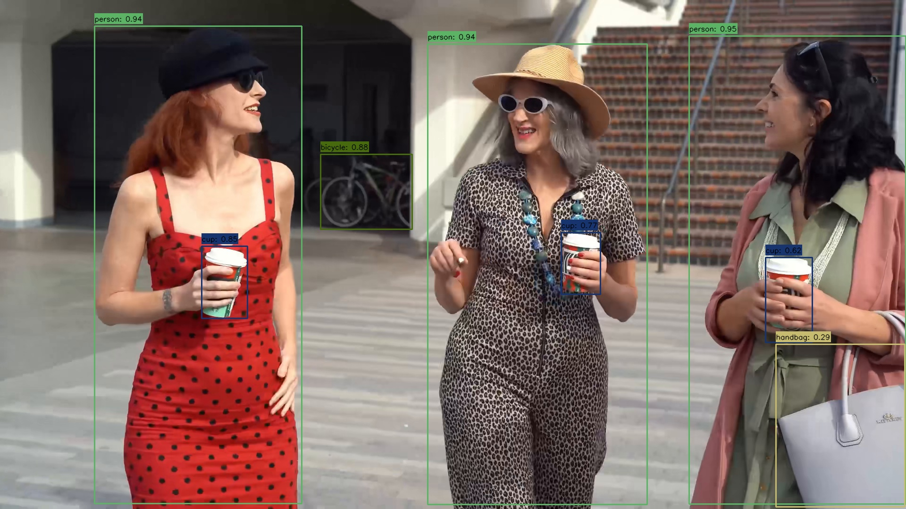

[EN](README.md) | **CN**

# Yolov8 示例

本示例使用 AMLNN 运行 YOLOV8。完整流程如下：

1. 将 ONNX 模型转换为 ADLA 模型。
2. 支持的输入格式。
3. 使用 ADLA 模型运行 Python 示例。
4. 使用 ADLA 模型运行 C++（Linux/Android）示例。
5. 查看检测图像/结果。

## 目录结构

```bash
examples/yolov8/
├── cpp/               # C++ demo and build scripts
├── input/             # Input images for demo
├── model/             # Put ONNX and ADLA models here
├── py/                # Python conversion and demo scripts
└── result.jpg         # Example detection output
```

## 许可证

本示例代码基于 Apache License 2.0 许可发布。详见仓库根目录的 [LICENSE](../../LICENSE) 文件。

Yolov8 模型由第三方提供。再分发或商用之前，请查阅并遵守模型来源方的许可证与使用条款。

本示例中的模型预处理和后处理代码部分由 AI 生成。若其中某些部分与既有工作相似并引起顾虑，请联系我们，我们会及时删除或调整。

## 1. 模型转换

在 `examples/yolov8/py` 目录下运行 ADLA 导出脚本：

```bash
cd examples/yolov8/py
python export_adla.py \
  --onnx ../model/model.onnx \
  --dataset-path ../../../resource/detection_dataset.txt \
  --target-platform 007 \
  --output-dir ../model
```

| 参数                | 说明                                                                                                                                     |
| ------------------- | ---------------------------------------------------------------------------------------------------------------------------------------- |
| `--onnx`            | 输入 `.onnx` 模型的路径。                                                                                                                |
| `--dataset-path`    | （可选）`.txt` 文件路径，其中列出用于量化校准的输入路径。使用 `w8a8` 和 `w8a16 (i16)` 配置时必须提供。[1]                                |
| `--target-platform` | 目标平台 ID。完整的目标平台支持列表见[**此处**](../../docs/mapping.md)。                                                                 |
| `--output-dir`      | （可选）生成的 `.adla` 模型的保存目录。默认为 `../model`。                                                                               |

> **[1] 量化数据集说明**
>
> 当使用 `activation_dtype="f16"` 时（例如 `w8a16 (f16)` 或 `w16a16 (f16)`），**不需要**校准数据集。请在 `amlnn.config()` 调用中显式设置该参数。
>
> 如果未提供数据集，AMLNN 不会报错，而是生成随机校准数据，这可能导致模型精度严重下降。
>
> `activation_dtype` 不适用于 `w8a8`。

转换完成后，AMLNN 生成的文件名保持不变。对于示例 `model.onnx`，在当前 `w8a8` 配置下，预期的模型路径为：

```text
examples/yolov8/model/model_w8a8.adla
```

## 2. 支持的输入格式

YOLOv8 推理示例既支持标准图像文件，也支持原始图像和直接输入模型张量两种格式。

| 格式                            | 说明                                                                                                                       |
| ------------------------------- | -------------------------------------------------------------------------------------------------------------------------- |
| `.jpg`, `.jpeg`, `.png`, `.bmp` | 使用 OpenCV 加载的标准图像文件，经过常规的 YOLOv8 预处理流程处理。                                                         |
| `.txt`                          | 以文本形式存储的原始 BGR `uint8` 图像像素值。*文件中不得包含形状头或元数据。*                                             |
| `.bin`                          | 以原始二进制形式存储的、预处理后的最终模型输入张量。直接传入 AMLNN 推理，不再进行预处理。                                 |
| `.qtxt`                         | 以文本形式存储的、预处理后的最终模型输入张量。直接传入 AMLNN 推理，不再进行预处理。                                       |

#### 标准图像输入

标准图像文件遵循常规的 YOLOv8 预处理流程：

```text
.jpg/.jpeg/.png/.bmp
    -> image loading
    -> letterbox resize
    -> BGR to RGB
    -> normalize
    -> quantize if required
    -> inference
```

### 原始 `.txt` 图像输入

`.txt` 文件表示取值为 `0` 到 `255` 的原始 BGR `uint8` 图像像素值。

文件中**仅包含像素值**，不包含形状头或其他元数据。图像形状假定与模型输入尺寸一致，格式为 `H x W x 3`。

处理之前，示例会校验 `.txt` 文件中的数值总数是否等于预期的输入图像元素个数：

```text
H x W x 3
```

输入流程如下：

```text
.txt
    -> read raw BGR uint8 pixel values
    -> verify element count matches H x W x 3
    -> reshape to H x W x 3
    -> BGR to RGB
    -> normalize
    -> quantize if required
    -> inference
```

> **说明：** `.txt` 文件必须已经包含模型输入分辨率所需的像素数，且不应包含形状头。如果数值个数与预期的 `H x W x 3` 尺寸不符，该输入将被跳过。


#### 直接使用 `.bin` 和 `.qtxt` 模型输入

`.bin` 和 `.qtxt` 格式包含**预处理和量化之后的最终模型输入张量**。

它们不包含维度、形状头或其他元数据。

* `.bin` 以原始二进制形式存储张量。
* `.qtxt` 以文本形式存储相同的张量数值。

读取张量时使用 AMLNN 报告的输入张量形状和数据类型，并直接传入 `amlnn.inference()`。

这些格式支持推理脚本所处理的 AMLNN 输入张量类型，包括 `float32`、`int8`、`uint8` 以及适用情况下的 `int16`。

由于 `.bin` 和 `.qtxt` 仅包含最终模型张量，原始源图像的尺寸和 letterbox 参数不可用。因此推理脚本会将该张量视为模型分辨率下的图像，即：

```text
scale = 1.0
pad = (0, 0)
```

对于这类直接张量输入，检测坐标以**模型输入坐标**显示，而不会映射回原始源图像的尺寸。

### 生成测试输入

独立的输入生成工具 `generate_inputs.py` 可以从普通图像文件生成 `.txt`、`.bin` 和 `.qtxt` 测试输入。

该工具接受 `.jpg`、`.jpeg`、`.png` 和 `.bmp` 等标准图像格式，不接受 `.txt`、`.bin` 或 `.qtxt` 文件作为源输入。

加载 ADLA 模型仅用于获取输入张量的尺寸、缩放系数、零点和张量类型。该工具不执行推理。

每张源图像会生成三个文件：

* `.txt`：包含未经处理的原始 BGR 图像数据。只有当源图像尺寸与模型输入尺寸一致时，该 `.txt` 文件才能用于推理示例。
* `.bin`：以原始二进制形式包含预处理并量化后的最终模型输入张量，可直接传入模型，无需额外的预处理或量化。
* `.qtxt`：包含与 `.bin` 相同的最终模型输入张量，但以文本形式存储张量数值。推理时同样跳过预处理和量化。

生成流程如下：

```text
input image
    |
    +-> original BGR image
    |       -> .txt
    |
    +-> YOLOv8 preprocessing
            -> letterbox
            -> BGR to RGB
            -> normalization
            -> quantization if required
                    |
                    +-> .bin
                    |
                    +-> .qtxt
```

在 `examples/yolov8/py` 目录下运行该工具：

```bash
cd examples/yolov8/py

python generate_inputs.py \
    --adla ../model/model_w8a8.adla \
    --image-dir ../input \
    --output-dir generated_inputs
```

参数说明：

| 参数           | 说明                                                                                                                      |
| -------------- | ------------------------------------------------------------------------------------------------------------------------- |
| `--adla` | 编译后的 `.adla` 格式 YOLOv8 模型路径。加载该模型仅用于获取其输入张量信息。                                                |
| `--image-dir`  | 包含待转换的源 `.jpg`、`.jpeg`、`.png` 或 `.bmp` 图像的目录。                                                             |
| `--output-dir` | （可选）生成的 `.txt`、`.bin` 和 `.qtxt` 文件的保存目录。默认为 `generated_inputs`。                                      |

对每张处理过的图像，该工具会生成全部三种格式：

```text
generated_inputs/
├── test_image.txt
├── test_image.bin
└── test_image.qtxt
```

`.bin` 和 `.qtxt` 文件包含最终的模型输入张量，不含图像形状或 letterbox 元数据，直接送入 AMLNN 推理，跳过图像加载、缩放、letterbox、颜色转换、归一化和量化等步骤。

## 3. 运行 Python 示例

### 前置条件

* Python 3.10
* 所需软件包：`amlnn`

### 安装依赖

```bash
pip install amlnn_edge_toolkit_lite-1.0.0-cp310-cp310-linux_aarch64.whl
```

### 在设备上运行

```bash
python yolov8_inference.py \
    --adla ../model/model_w8a8.adla \
    --image-dir ../input \
    --conf 0.25 \
    --nms 0.4
```

参数说明：

| 参数           | 说明                                                                                 |
| -------------- | ------------------------------------------------------------------------------------ |
| `--adla`       | 编译后的 `.adla` 格式模型路径。                                                      |
| `--image-dir`  | 测试图像所在目录。                                                                   |
| `--conf`       | （可选）用于过滤检测结果的置信度阈值。默认为 `0.25`。                                |
| `--nms`        | （可选）非极大值抑制过程中使用的 IoU 阈值。默认为 `0.4`。                            |

脚本会自动处理指定图像目录下的所有受支持的输入文件（`.jpg`、`.jpeg`、`.png`、`.bmp`、`.bin`、`.txt`、`.qtxt`），并将结果保存到 `{model_name}_result` 文件夹。

## 4. 运行 C++ 示例

### 为 Android 构建

#### 前置条件

* 系统中已安装 **Android NDK**（推荐 r27d）。
* 已下载并解压 **AMLNN Toolkit**。
* 预编译的 Android 版 OpenCV 位于 `dependency/opencv/` 文件夹。

#### 1. 设置环境

导出 NDK（工具链）与 AMLNN（神经网络依赖）的路径，以便脚本能够找到它们。

```bash
export ANDROID_NDK_PATH=/path/to/android-ndk-r27d
export AMLNN_HOME=/path/to/amlnn-toolkit/amlnn_runtime
```

#### 2. 构建

进入 C++ 目录并运行构建脚本。

```bash
cd examples/yolov8/cpp

# Build for 64-bit (arm64-v8a) - Default
./build-android.sh

# Build for 32-bit (armeabi-v7a)
./build-android.sh -a armeabi-v7a
```

可执行文件将生成在所选 Android ABI 对应的构建目录中：

* 64 位：`build/android/arm64-v8a/yolov8_demo`
* 32 位：`build/android/armeabi-v7a/yolov8_demo`

#### 3. 运行示例

以下示例使用默认的 64 位（`arm64-v8a`）构建。

```bash
# Push executable and assets to device
adb shell "mkdir -p /data/local/tmp/"
adb push build/android/arm64-v8a/yolov8_demo /data/local/tmp/
adb push ../model/model_w8a8.adla /data/local/tmp/
adb push ../input/ /data/local/tmp/

# Run on device
adb shell
cd /data/local/tmp
chmod +x yolov8_demo
export LD_LIBRARY_PATH=/vendor/lib64

# Usage: ./yolov8_demo <model_path> <image_dir>
./yolov8_demo model_w8a8.adla input/
```

> **说明：** 若使用 32 位（`armeabi-v7a`）构建，请改用 `build/android/armeabi-v7a/yolov8_demo` 及对应的 32 位库路径。请将 `model_w8a8.adla` 替换为实际的模型文件名。

---

### 为 Linux 构建

Linux 构建流程支持两种不同模式：

1. **标准 Linux 交叉编译**（默认）
2. **Yocto SDK 编译**

#### 模式 1：标准 Linux 交叉编译（默认）

##### 前置条件

* GCC 交叉编译工具链（推荐 GCC 10.3）。
* 工具链的 `bin/` 目录必须加入系统 `PATH`。
* 预编译的 OpenCV 位于 `dependency/opencv/` 文件夹。
* 已设置 `AMLNN_HOME` 环境变量。

##### 1. 设置环境

将下载的工具链加入 `PATH`，并导出 `AMLNN_HOME` 变量，以便脚本能够找到编译器和神经网络依赖。

```bash
# Export the AMLNN path
export AMLNN_HOME=/path/to/amlnn-toolkit/amlnn_runtime

# For 64-bit (aarch64) builds, add the 64-bit toolchain to PATH:
export PATH=/path/to/gcc-arm-10.3-2021.07-x86_64-aarch64-none-linux-gnu/bin:$PATH

# OR for 32-bit (arm) builds, add the 32-bit toolchain to PATH:
export PATH=/path/to/gcc-arm-10.3-2021.07-x86_64-arm-none-linux-gnueabihf/bin:$PATH
```

##### 2. 构建

```bash
cd examples/yolov8/cpp

# Build for 64-bit (Default)
./build-linux.sh

# Build for 32-bit
./build-linux.sh -b 32
```

> **可选覆盖：** 如果编译器的前缀名不同（例如使用 `aarch64-linux-gnu` 而非 `aarch64-none-linux-gnu`），可以通过设置 `GCC_COMPILER` 变量覆盖默认值：

```bash
GCC_COMPILER=aarch64-linux-gnu ./build-linux.sh
```

可执行文件将生成在所选架构对应的构建目录中：

* 64 位：`build/linux/64/yolov8_demo`
* 32 位：`build/linux/32/yolov8_demo`

#### 模式 2：Yocto/Debian/Armbian 构建

##### 1. 前置条件

* 已安装 Yocto SDK。
* 已有可用的 CMake Toolchain 文件。
* 预编译的 OpenCV 位于 `../../../dependency/opencv/`（相对于脚本目录）。

##### 2. 设置环境

```bash
# Export the AMLNN path
export AMLNN_HOME=/path/to/amlnn-toolkit/amlnn_runtime
```

##### 3. 构建

```bash
cd examples/yolov8/cpp

# Build for Yocto 64-bit (Default)
./build-linux.sh -m yocto -s /path/to/yocto_sdk_root -t /path/to/toolchain.cmake

# Build for Yocto 32-bit
./build-linux.sh -m yocto -b 32 -s /path/to/yocto_sdk_root -t /path/to/toolchain.cmake
```

> **说明：** 也可以使用 `YOCTO_SDK_ROOT` 和 `TOOLCHAIN_FILE` 环境变量，而无需传入 `-s` 和 `-t` 参数。

可执行文件将生成在所选架构对应的构建目录中：

* 64 位：`build/yocto/64/yolov8_demo`
* 32 位：`build/yocto/32/yolov8_demo`

#### 3. 运行示例

以下示例使用默认的 64 位 Linux 构建。

```bash
# Push executable and assets to device (adjust build path if using Yocto)
adb shell "mkdir -p /data/local/tmp/"
adb push build/linux/64/yolov8_demo /data/local/tmp/
adb push ../model/model_w8a8.adla /data/local/tmp/
adb push ../input/ /data/local/tmp/

# Run on device
adb shell
cd /data/local/tmp
chmod +x yolov8_demo

# Usage: ./yolov8_demo <model_path> <image_dir>
./yolov8_demo model_w8a8.adla input/
```

> **说明：** 请将 `model_w8a8.adla` 替换为实际的模型文件名。若使用 32 位或 Yocto 构建，请相应调整可执行文件路径。

## 5. 结果

### 性能信息

将日志级别设置为 `INFO` 后，程序会在推理结束后输出运行时性能信息。控制台输出可能包含：

* **硬件信息：** 系统版本和 ADLA 库版本。
* **模型概览：** 输入和输出张量配置。
* **NPU 指标：** 推理时延和 DRAM 带宽占用。

### 检测输出

示例会对每张输入图像执行目标检测，并保存包含检测框的可视化结果。

结果图像以输入图像名保存在模型结果目录中。例如：

```text
<model_name>_result/
└── test_image_result.jpg
```

可以从设备上拉取结果图像进行查看：

```bash
adb pull <model_name>_result/test_image_result.jpg
```


